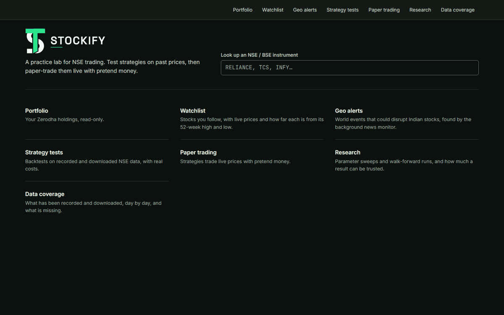

# STOCKIFY



STOCKIFY is a practice lab for trading on India's National Stock Exchange. You write a rule, test it on past prices with the costs, fills and margin a real account would face, then let it paper-trade live prices with pretend money. It never places a real order.

The question it exists to answer: would this rule have made money after realistic costs, and does it keep making money once it meets live prices?

It runs on Windows, on one machine, for one person. Money is in rupees, stored as whole paise. Times are stored in UTC and shown in IST.

## What you can do with it

**Test a strategy.** Pick a strategy, a stock or index, a date range and how orders should fill, then press Start. The run page shows the result as tiles, a candlestick chart with every buy and sell marked on it, a trust panel, the money-over-time curve and every fill, with each charge broken out the way Zerodha bills it. Run the same test twice and you get the same bytes twice.

**Find out whether a good result was luck.** The trust panel re-draws the run's own days to show how far Sharpe, the average day and the worst drop could swing. It counts every variation you have tried on an idea and discounts the best one for it (the deflated Sharpe), and splits the profit by month, weekday, expiry days, India VIX and the opening gap. A run too short for a yearly figure says "too short to say" instead of extrapolating one day into a year.

**Research without a terminal.** A parameter sweep starts from any finished test: choose which settings to vary, see how many tries that makes, press Run sweep. A finished sweep can be walked forward (train on some days, pick the best settings, test them on the days after). A run's sensitivity check re-runs it with higher costs and worse fills. Long jobs show their progress and have a Stop button.

**Compare runs.** Tick two to six finished tests and see their numbers, growth curves, drawdowns, caveats and settings side by side, with the differences marked.

**Paper-trade live.** Sessions trade the live Kite feed with pretend money, unattended through the day. They journal every event, recover from crashes and disconnects, and replay each night to prove the day can be reproduced exactly.

**Keep the data honest.** The data coverage page shows, day by day, what was recorded, archived and downloaded, and what is missing. Missing NSE days download with one button. The recorder records every trading day by itself, compacts the day to verified Parquet, backs it up, hibernates the laptop and wakes it for the next session. It emails you when the daily Kite login is due, when it stalls, when disk runs low, and with a summary after each day.

Strategies that ship with it: Buy and Hold, SMA Crossover, Opening Range Breakout (in Python and in C++), End-of-Day Short Straddle, Short Straddle with Stop, Iron Fly and Margin Watch. Writing your own is covered in [`docs/plan/HOWTO_strategy.md`](docs/plan/HOWTO_strategy.md), and options work in [`docs/plan/HOWTO_options.md`](docs/plan/HOWTO_options.md).

## How it is built

- **Data** comes from Kite Connect (instruments, historical candles and the KiteTicker WebSocket) and from NSE's public files: the end-of-day bhavcopies and the exchange's own margin files (the SPAN risk files and the extreme-loss-margin file). The archive holds NSE's end-of-day SPAN file for every trading day from January 2009.
- **The engine** is a deterministic C++20 core in `engine/` that handles orders, fills, costs, the ledger, settlement and margin. Python sees it as `stockify._engine`, and strategies can be written in Python or C++.
- **The oracle** in `stockify/oracle/` is a small, readable Python backtester written to the same contract. The engine has to agree with it to the paisa, and a fuzzer runs both on random worlds; any difference fails the build.
- **Costs** follow Zerodha's charges: brokerage, STT, exchange fees, GST, stamp duty, DP charges and expiry-day brokerage. Every rate is a dated config row with its source. A date with no sourced row is refused rather than guessed.
- **Futures and options** have option chains with implied volatility and greeks (Black-76), rolls, freeze-limit slicing, expiry settlement and physical delivery.
- **Margin** is priced from the exchange's own files where it can be. Each day a run takes the best of five steps: exact SPAN with NSE's extreme-loss file, exact SPAN with the dated rule, a calibrated estimate, a placeholder estimate, then a flat rate. Checked against 405 margin answers from Kite, the exact step agreed with every one, the worst by ₹0.85.
- **The app** is a FastAPI backend in `server/` and a desktop Next.js UI in `web/`. Both bind to `127.0.0.1` only.
- **The geo monitor** in `geo_monitor/` is a separate process that watches world news for events that could move Indian stocks.

## Status

All seven milestones are built, reviewed and merged into `main`.

| Milestone | What it added |
|---|---|
| M0 | The old pipeline removed; the C++ engine building on Windows |
| M1 | Instruments with history, NSE files, the bar cache, the tick recorder, replay, compaction to Parquet, event packs, the data-quality report |
| M2 | The Python oracle, golden scenarios, end-of-day option research |
| M3 | The C++ engine for equities, three fill models, costs, metrics, the strategy tests page |
| M4 | Futures and options: contract rules, Black-76, chains, expiry, delivery, SPAN margin |
| M5 | The paper-trading daemon: sessions, journals, crash recovery, live margin, nightly checks, the paper trading page |
| M6 | Comparing runs, data coverage, the trust panel, sweeps, walk-forward, cost and fill sensitivity, candlestick charts |

What is still open is live time: a run of unattended recording days, and paper sessions that pass their nightly checks for five live trading days in a row.

`main` holds the whole platform. The `stockify/m1-data` through `stockify/m6-research` branches are kept as a record of how the work was divided. The plan, every decision (the `D-xx` rows) and notes on what the code really looks like are in [`docs/plan/`](docs/plan/README.md).

## Getting started

You need PowerShell 7, Python 3.11 or 3.12 (x64) and Node.js 20.9 or later. Building the engine also needs Visual Studio Build Tools with the "Desktop development with C++" workload and "C++ CMake tools for Windows". The launcher checks these versions, manages the virtual environment and the `npm ci` install, and supervises the processes it starts.

```powershell
.\run.ps1                          # the API on :8001 and the web app on :3000
.\run.ps1 -BuildEngine             # build and test the C++ engine, then exit
.\run.ps1 -Daemon                  # API, web app and the recorder (restarts on a crash)
.\run.ps1 -DaemonOnly              # the recorder only
.\run.ps1 -Reload                  # the API reloads on code changes (its log opens in its own window)
.\run.ps1 -GeoMonitor              # API, web app and the geo monitor
.\run.ps1 -MonitorOnly             # the geo monitor only
.\run.ps1 -Fresh                   # rebuild .venv and reinstall the Python packages
.\run.ps1 -InstallWeb              # force npm ci in web/
.\run.ps1 -ApiOnly | -WebOnly
.\run.ps1 -ApiPort 8002 -WebPort 3001
```

Then open http://127.0.0.1:3000. The web dev server forwards `/api/*` to `STOCKIFY_API_ORIGIN`, and the API uses `STOCKIFY_WEB_ORIGIN` for CORS and the redirect after the Kite login. Both have to be loopback addresses.

To run the two processes by hand once `.venv` and `web/node_modules` exist, use two terminals:

```powershell
# Terminal 1: the API
$env:STOCKIFY_WEB_ORIGIN="http://127.0.0.1:3000"
.\.venv\Scripts\python.exe -m uvicorn server.main:app --reload --host 127.0.0.1 --port 8001

# Terminal 2: the web app
$env:STOCKIFY_API_ORIGIN="http://127.0.0.1:8001"
cd web; npm run dev -- --hostname 127.0.0.1 --port 3000
```

Settings and secrets go in `.env` at the repo root. It is never committed.

```
KITE_API_KEY=...           # your Kite Connect app (the ₹500/month plan covers live and historical data)
KITE_API_SECRET=...
GOOGLE_AI_API_KEY=...      # Gemini, for the geo monitor's classification

# Email for the recorder's alerts and the geo monitor (port 587 uses STARTTLS, 465 uses SSL)
ALERT_EMAIL_TO=you@example.com
SMTP_HOST=smtp.gmail.com
SMTP_PORT=587
SMTP_USER=...
SMTP_PASSWORD=...          # for Gmail, an app password
SMTP_FROM=you@gmail.com
GEO_MONITOR_INTERVAL_SEC=600
GEO_MONITOR_WHEN=1h
```

The daily Kite access token is not kept in `.env`. You get it each trading day with "Login to Kite" on the Portfolio page, and it is cached at `%LOCALAPPDATA%\STOCKIFY\kite\kite_token.json`. In the Zerodha developer console, register `http://127.0.0.1:8001/api/kite/callback` as the redirect URL.

To check that Kite and email both work:

```powershell
.\.venv\Scripts\python.exe -m stockify kite check     # API key, token, quotes, history and the live feed
.\.venv\Scripts\python.exe -m stockify notify test    # sends one test email
```

### Building the engine

If the C++ workload is missing, add it to the installed Build Tools. It needs admin rights and is a large download:

```powershell
& "${env:ProgramFiles(x86)}\Microsoft Visual Studio\Installer\setup.exe" modify `
  --installPath "<Build Tools install path>" `
  --add Microsoft.VisualStudio.Workload.VCTools `
  --add Microsoft.VisualStudio.Component.VC.CMake.Project --includeRecommended --passive
```

`.\run.ps1 -BuildEngine` enters the Visual Studio developer shell, configures the `win-msvc-release` preset (Ninja) against the venv's Python and pybind11, builds, copies `_engine*.pyd` into `stockify/`, runs `ctest` and prints the engine's build info. The engine is compiled with `/fp:precise`, so the arithmetic is the same everywhere, with Control Flow Guard and the SDL checks on. Rebuild it on each machine you run STOCKIFY on.

### Recording every trading day

The recorder runs as a scheduled task that starts when you log in to Windows. On each trading day it records the session, compacts it, backs it up, then hibernates the laptop once you have been away from it for 15 minutes, and wakes it for the next session.

```powershell
.\scripts\check_power.ps1                       # the lid, sleep, wake-timer and CPU settings it needs
.\scripts\manage_stockify_daemon.ps1 Install     # start the recorder at logon
.\scripts\manage_stockify_daemon.ps1 Status      # task state, next wake and where the log is
.\scripts\run_stockify_daemon.ps1 -SleepTest     # hibernate now and wake by itself in 5 minutes
.\.venv\Scripts\python.exe -m stockify calendar   # upcoming sessions and Kite login windows in your time zone
```

Kite tokens expire at 06:00 IST every day, so log in once before each trading day, inside the window `calendar` shows. In Seattle that is the evening before, roughly 4:30 to 7:30 PM in winter. The log is at `%LOCALAPPDATA%\STOCKIFY\logs\stockify-daemon.log`.

The nightly backup goes to `~/STOCKIFY-backup` (set in `stockify/config/storage.json`) and keeps the newest seven daily database snapshots. Recorded ticks, journals and NSE files are copied incrementally and checked against their checksums.

To rehearse the recorder on a day you have already recorded, without touching the real lab:

```powershell
.\.venv\Scripts\python.exe -m stockify daemon --recorder-only --ticker replay:2026-11-05:max --replay-sandbox C:\some\empty\folder
```

### The geo monitor

The geo monitor runs outside the API, so it keeps watching the news when the API is down. The Geo alerts page also has a
"Check the news now" button that runs one check inside the app; it never overlaps the background monitor's own check.

```powershell
.\scripts\run_geo_monitor.ps1 -Once -DryRun
.\scripts\manage_geo_monitor.ps1 Install | Start | Status   # a per-user scheduled task
```

See [`geo_monitor/README.md`](geo_monitor/README.md).

## The command line

Everything in the web app also has a command, which is useful for scripting. Each one is `.\.venv\Scripts\python.exe -m stockify …` (shortened to `stockify …` below), and `stockify --help` lists them all.

```powershell
# Getting data in
stockify refdata --help                                      # instruments with history (Kite dumps)
stockify nse backfill --from 2024-01-01                      # NSE end-of-day files for every trading day (resumable)
stockify nse margin-files --backfill 2009-01-02 2026-11-06   # NSE's end-of-day SPAN margin files (resumable)
stockify nse margin-files --date 2026-11-09                  # one day: every SPAN file plus the ELM file
stockify bars fetch --help                                   # Kite historical candles into the bar cache
stockify compact --help                                      # a recorded day into verified Parquet
stockify pack --help                                         # the event packs the engine reads

# Backtests
stockify run --config examples\runs\sma_reliance_daily.json      # on the C++ engine
stockify run --config examples\runs\sma_reliance_daily.json --impl oracle
stockify run --rerun <run id>                                     # must reproduce the run byte for byte
stockify tools compare-strategies --config <file>                 # several strategies on the same days

# Research
stockify sweep --config examples\sweeps\orb_grid.yaml             # a parameter sweep
stockify walkforward --sweep examples\sweeps\orb_grid.yaml        # walk a sweep forward
stockify sensitivity --run <run id>                               # costs and fills made worse

# Margin
stockify margin check --leg "SELL 65 NIFTY26N1724950CE" --leg "SELL 65 NIFTY26N1724950PE" --date 2026-11-09 --at 10:00
stockify margin scorecard                       # how far each margin step is from Kite's stored answers
stockify margin span-validate --date 2026-11-09 # the exact SPAN calculator against Kite's answers for a day
stockify margin calibrate                       # in market hours with a fresh login; asks Kite for margins, places nothing
```

The run configs in `examples/runs/` cover a daily moving-average cross, a one-minute opening-range breakout in Python and in C++, an end-of-day short straddle under two margin models, and a straddle against an iron fly on recorded option chains. Results land under `%LOCALAPPDATA%\STOCKIFY\kite\lab\runs\` and appear on the strategy tests page.

## Safety

- STOCKIFY reads quotes, candles, the portfolio and margin answers from Kite. Nothing in it places, changes or cancels an order. The Kite client has its order routes removed and can only send the read-only requests on an allowlist.
- Strategy files are checked before they run and may import only a short list of safe modules.
- Kite keys live in `.env` and the daily token only in the token store under `%LOCALAPPDATA%\STOCKIFY\`. Neither is written to logs, files or output, and a pre-commit hook runs a secret scan that fails closed.
- Recorded ticks can't be replaced (Kite keeps no data for expired options), so the stores only ever change by migration, never by dropping data.
- Charges, sessions, contract rules, freeze limits and margin settings are dated config rows with a source, in `stockify/config/`, with the facts in `docs/plan/01_facts.md`. None of them are written into the code.
- Market data from Kite is for your own use, so recordings stay on your machine and in your backup, never in this repository.

## Checking it works

```powershell
.\.venv\Scripts\python.exe tests\run_tests.py              # offline and credential-free (stdlib unittest); it takes a while
.\.venv\Scripts\python.exe tests\run_tests.py stockify     # only test ids containing "stockify"
ctest --preset win-msvc-release                            # from engine/, inside the VS developer shell
.\.venv\Scripts\python.exe -m stockify config              # validate stockify/config/
.\.venv\Scripts\python.exe -m stockify engine              # the engine's build info
.\.venv\Scripts\python.exe -m stockify golden run          # every golden scenario
.\.venv\Scripts\python.exe -m stockify tools fuzz --help   # the oracle against the engine on random worlds
cd web; npm run lint; npm run build
```

The test runner exits with code 3 when the C++ engine can't be loaded, so a run that quietly skipped every engine test can't pass. Build the engine, or pass `--python-only` when a Python-only run is what you want.

A quick check that the API is up: `GET http://127.0.0.1:8001/api/health` returns `{"ok":true,"service":"stockify-api"}`.

## Where things are

```
server/          FastAPI: auth, search, portfolio, live ticks, alerts, tests, research, paper trading, data
web/             Next.js 16 desktop UI (types mirrored in web/src/lib/types.ts; design rules in web/design.md)
stockify/        the Python package and CLI (python -m stockify)
  config/        dated market rules (charges, sessions, contract rules, freeze limits, margin, calendar)
  data/          instruments, NSE files, the margin-file archive, bar cache, ticks, compaction, packs, quality
  daemon/        recorder, scheduler, paper sessions, journals, keep-awake, replay ticker, notifications
  oracle/        the reference Python backtester
  fno/           Black-76, rolls, the SPAN file reader, exact SPAN, the margin steps, calibration
  research/      trial families, deflated Sharpe, bootstrap, regimes, sweeps, walk-forward, sensitivity
  reporting/     comparisons, exports, data coverage, the figures a run may show
  strategies/    the strategies that ship with the lab
  tools/         benchmark, fuzzer, charge capture, strategy comparison, replay
engine/          C++20 core (stocksim_core), the pybind module stockify._engine, the stocksim_run CLI, doctest tests
  third_party/   vendored single headers (see VERSIONS.md)
examples/        ready-to-run backtest configs (runs/) and a sweep (sweeps/)
geo_monitor/     the standalone news monitor (Gemini), writing geo_alerts.sqlite
gnews/           Google News RSS client
docs/plan/       the plan, decisions, facts, how-to guides and RECON notes
tests/           the offline unittest suite (tests/stockify/ for the stockify package)
kite_client.py, kite_ticker_worker.py, tick_buffer.py, portfolio_sync.py,
geo_alerts.py, india_utils.py, stockify_paths.py
```

Everything that changes at runtime lives under `%LOCALAPPDATA%\STOCKIFY\` (resolved by `stockify_paths.py`), and the simulation stores under `…\STOCKIFY\kite\lab\`. Market data from NSE and Kite remains theirs, and the TradingView Lightweight Charts licence notice is in [`NOTICE`](NOTICE).
