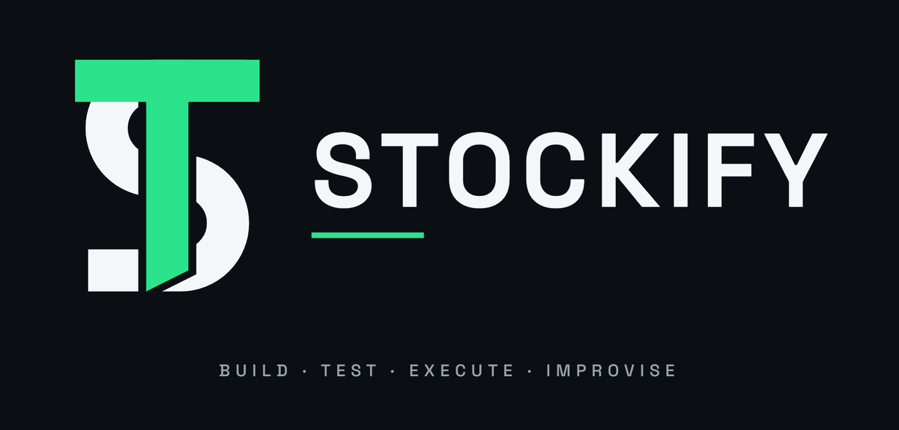
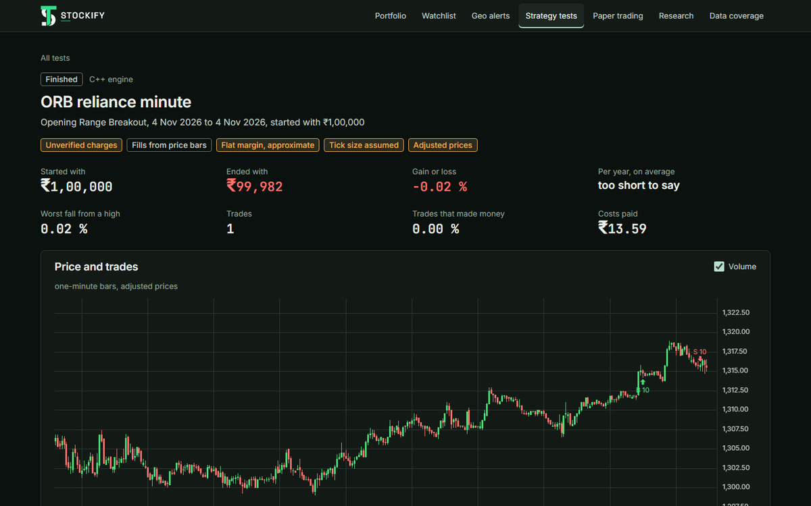
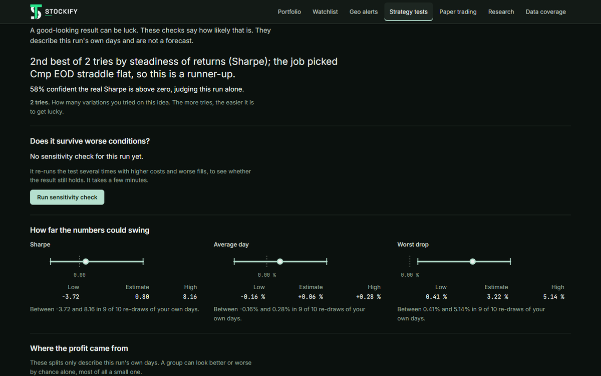
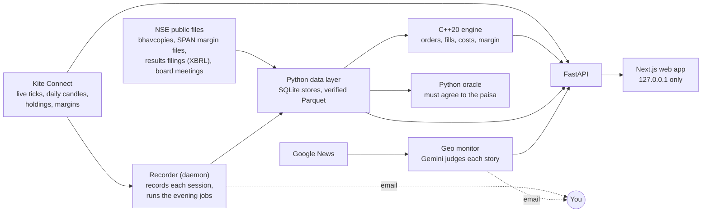

<h1 align="center"></h1>

Information about stocks on India's National Stock Exchange is scattered: prices and option chains in a broker's app, results filings and board-meeting dates on NSE's site, margin rules in the exchange's own files, news everywhere else. STOCKIFY puts all of it in one place on your own computer, and leaves the decision to you. It doesn't push one way of investing. It gives each kind of investor the evidence they need:

- **A long-term investor** can see whether a stock costs more than it is worth next to its own industry, judged on the results the company filed with NSE, before paying for it.
- **A swing trader** gets daily charts, seven well-known swing rules tested on each stock they hold or watch, a plain suggestion for each holding, and an email when a watched stock breaks its 52-week range.
- **A day trader who relies on technical strategies** can test a rule on recorded tick data with the costs, fills and margin a real Zerodha account would face, check whether a good result was luck, then paper-trade it on live prices with pretend money.

It never places a real order.

## At a glance

- **What it is:** a research and practice platform for the NSE: fundamentals screening, a watchlist with alerts, backtesting and paper trading, all on one machine.
- **Stack:** a C++20 engine (with Python bindings), Python for data and strategies, FastAPI, a Next.js 16 web app, SQLite and Parquet for storage, and Kite Connect and NSE's public files for data.
- **The engine is deterministic and checked:** a separate Python backtester written to the same contract has to agree with it to the paisa, and a fuzzer runs both on random worlds.
- **Margin matches the broker:** checked against 405 margin answers from Kite, the exact SPAN step agreed with every one, the worst by ₹0.85.
- **About 4,300 automated tests**, offline and credential-free.


## A sample result

Nobody can run STOCKIFY without Windows and a Kite Connect subscription, so here is what a finished test looks like. This is an Opening Range Breakout test on RELIANCE's one-minute bars for 4 November 2026, starting with ₹1,00,000. It made one trade and ended with ₹99,982: a small loss once ₹13.59 of charges were paid. The tags under the title ("Unverified charges", "Fills from price bars", "Flat margin, approximate" and so on) name every assumption the result rests on, so a good-looking number can't hide one.



Every test also gets a trust panel. This one, from an end-of-day short straddle test, says how many variations of the idea were tried, how confident it is that the real Sharpe is above zero, and how far the Sharpe, the average day and the worst drop could swing on re-drawn days.



## How the pieces fit



It runs on Windows, on one machine, for one person. Money is in rupees, stored as whole paise. Times are stored in UTC and shown in IST.

## Fundamentals: is a stock worth its price?

This is the long-term investor's page: before you buy, it tells you whether you'd be paying more for a stock than its industry's own numbers would suggest. The Fundamentals page (Research, then Fundamentals) lists stocks that look cheap and healthy against their own industry, judged on the results the companies file with NSE, and each stock's Details page puts its price next to its figures. It is a list of ideas to research. It never says "buy", it shows no score or rank number, and nothing on it can place an order.

The page has three parts.

- **Results coming up.** The covered companies that have a board meeting for their results in the next four weeks.
- **Worth a closer look.** The day's list, best first, at most 50 stocks, each with a few words on why, such as "cheaper than its industry on earnings, with wider margins and no debt". A warning comes first when there is one, such as falling profits or rising debt. A loss-making stock, or one with negative equity, is never listed, though its details page still shows its figures and the warning. The order is the judgement; how it is worked out stays off the page.
- **Details.** The stock's price: the last close, the 52-week high and low with their dates, and a chart of the last 3 years of daily candles. Then its figures beside its industry's median: P/E, P/B, return on equity, debt to equity, operating margin and profit growth (a bank or other financial is judged on P/E, price to book, return on equity and net interest income growth; its profit growth is shown, but not used for the order). A chart of each figure by quarter, and every filing the figures came from, with a link to NSE's own file. A stock that is covered but not on the list says why: its results are out of date or could not be read, or it has no price to judge it by.

Where the figures come from:

- **The companies.** Today's Nifty 500 list from NSE, kept to the stocks whose median daily traded value over the last three months is at least ₹8 crore. Each stock's industry is the Industry column of that same list. (NSE's quote pages give a finer grouping, but they refuse automated reads.) An industry with fewer than five stocks on the list is compared with all of them instead.
- **The results.** NSE's results filings in XBRL from April 2021, and the integrated filings that companies have made since the quarter ended March 2025. Consolidated figures are used from the day a company first files them, standalone ones before that, never a mix. A figure counts from the first trading day after NSE broadcast it, so a past day's list uses only what was known on that day. A restated result is kept as a new version, never written over the old one. A filing whose figures do not add up is held back with the reason, never guessed.
- **The prices.** NSE's end-of-day files give each day's market value. Kite's daily candles (see Daily prices) give the price chart, the 52-week range and the test record.

The daemon brings it up to date each evening after the close, from 20:40 IST once the day's NSE files are in. It makes about 900 NSE requests per trading day at most, about one a second (a catch-up after several missed evenings can spend each missed day's budget in one sitting), and stops 10 minutes before the next session's preparation; what is left waits for the next evening.

What it cannot tell you:

- It covers today's listed companies only. A company that has since left the Nifty 500, merged or delisted is missing from the past lists too, so the past looks better than it was.
- The industries are today's NSE groups, used for every past day as well.
- The test record walks the list forward: a year to choose the settings, then the next 90 days, from 2022 to 31 July 2026, the day before the months the research page keeps in reserve. It compares the basket with Kite's Nifty 500 index, which is a price index without dividends.

The commands:

```powershell
stockify fundamentals backfill        # the first fill: every company's filings since April 2021, a few hours (resumable; --from, --limit)
stockify fundamentals refresh         # one evening's update now, within the day's 900 NSE requests
stockify fundamentals test-record     # the walk-forward test record (needs a Kite login; fetches daily prices first)
stockify fundamentals status          # read-only: coverage against the 90 % / 80 % parse gate, held filings by reason, the budget used
stockify fundamentals reparse --all-held   # held filings read again by the next run (or --symbol S), e.g. after a taxonomy.json addition
```

The backfill, refresh and test-record commands refuse to start while the recorder's session is running, so run them after the close; a backfill still going when the session begins stops at the next batch and resumes next time. Only one fundamentals run (the daemon's or a command's) goes at a time: a command started while another runs says so and stops.

## Watchlist

The Watchlist is where swing trading starts: the stocks you are thinking about, each with its 52-week range, its chart and what the tested rules say, plus an email when one breaks out. It holds up to 50 NSE stocks or ETFs. Add one from the search box and remove it with its button. Indices and government bonds are refused.

- **Each row** shows the price, live while the app is open and the last close otherwise; the 52-week high and low with how far the price is from each; and the holdings desk's suggestion for that stock, linking to its page. A stock the desk has not graded yet says "Not graded yet" (the desk grades at most 10 new stocks a night, so a long list fills in over a few nights).
- **The chart** under each row shows the last 3 years of daily candles, with the 52-week high and low drawn across it. The same chart is on each Fundamentals Details page. How much history it shows is `chart_days` in `stockify/config/watchlist.json`.
- **Email alerts, with the app closed.** Watched stocks join the recorder's feed, so their sessions are recorded too. During the session the recorder emails you when one trades above its 52-week high or below its 52-week low (once per stock per side per day, gathered into one email a minute and at most six emails a day). After the evening's results calendar update it emails a reminder for any watched company whose results meeting is in the next two trading days. Both go through the same email settings as the recorder's other alerts.
- **When a change takes effect.** A stock you add is recorded and alerted from the next session; a stock you remove stops alerting within a minute. Daily prices for a new stock arrive with that evening's candle fetch, and until then its row says so.
- **What the alerts skip.** A stock with less than a year of daily prices has no 52-week range yet. On the morning of a split or bonus, when the live price and the stored prices disagree, that stock's alerts pause for the day rather than send a false alarm. A rehearsal on a recorded day (`--ticker replay:…`) logs its alerts and never emails them.

## Holdings desk

Open a stock on the Portfolio page and you get a page for that holding: its daily chart with each rule's exit level, one suggestion (Hold, Tighten stop, Trim, Exit, or No reliable signal when no rule has a record worth weighing on that stock), and the rules behind it. The desk works on stocks only: it has no option chain and no option ideas. It suggests and never orders. Nothing on it can place a trade, and it reads only your holdings and daily prices through Kite's read-only calls.

How a suggestion is made: the desk updates once a day, after the session, when the recorder has finished. That night it tests the swing rules on each held stock's daily prices, with the lab's realistic costs, year by year against simply holding. Each rule gets a record on that stock (strong, some, weak or none), and the rules vote at that day's close, weighted by their record. The page shows the suggestion as of that close and its date, the votes, the price levels that would change the suggestion, and the table that turns votes into a word. Every rule decides on daily closes, so for swing trading this is the same answer a live view would give; a move through a level during the day shows after that day's close. The tests stop on 31 July 2026, the day before the months the research page keeps in reserve, so the desk never looks at them to grade a rule; the day's vote does use every close up to that day, because it is not a test.

Stocks on your watchlist that you don't hold get the same daily view, so you can see what the tested rules say about a stock before you buy it. Their page says it is a watched stock, not a holding.

Your cost and your profit are deliberately not shown anywhere on the desk, and they play no part in a suggestion.

## Testing strategies and paper trading

**Test a strategy.** Pick a strategy, a stock or index, a date range and how orders should fill, then press Start. The run page shows the result as tiles, a candlestick chart with every buy and sell marked on it, a trust panel, the money-over-time curve and every fill, with each charge broken out the way Zerodha bills it. Run the same test twice and you get the same bytes twice.

**Find out whether a good result was luck.** The trust panel re-draws the run's own days to show how far Sharpe, the average day and the worst drop could swing. It counts every variation you have tried on an idea and discounts the best one for it (the deflated Sharpe), and splits the profit by month, weekday, expiry days, India VIX and the opening gap. A run too short for a yearly figure says "too short to say" instead of extrapolating one day into a year.

**Research without a terminal.** A parameter sweep starts from any finished test: choose which settings to vary, see how many tries that makes, press Run sweep. A finished sweep can be walked forward (train on some days, pick the best settings, test them on the days after). A run's sensitivity check re-runs it with higher costs and worse fills. Long jobs show their progress and have a Stop button.

**Compare runs.** Tick two to six finished tests and see their numbers, growth curves, drawdowns, caveats and settings side by side, with the differences marked.

**Paper-trade live.** Sessions trade the live Kite feed with pretend money, unattended through the day. They journal every event, recover from crashes and disconnects, and replay each night to prove the day can be reproduced exactly.

**Keep the data honest.** The data coverage page shows, day by day, what was recorded, archived and downloaded, and what is missing. Missing NSE days download with one button. The recorder records every trading day by itself, compacts the day to verified Parquet, backs it up, hibernates the laptop and wakes it for the next session. It emails you when the daily Kite login is due, when an index goes silent mid-session, when disk runs low, when a session hits an error or a nightly check fails, and with a summary after each day. For the stocks on your watchlist it also emails you when one makes a new 52-week high or low during the session, and a day or two before one announces its results.

**Watch the news.** A news monitor reads Google News in the background for world events that could move Indian stocks, has Gemini judge each one, and emails you the high and critical ones. The Geo alerts page lists them, shows when the last check ran, and has a "Check the news now" button that runs a check on the spot (it never overlaps the background monitor's own check).

Strategies that ship with it: Buy and Hold, SMA Crossover, Opening Range Breakout (in Python and in C++), End-of-Day Short Straddle, Short Straddle with Stop, Iron Fly and Margin Watch, plus seven swing rules for the stocks you hold or watch: EMA Trend, MACD Crossover, RSI Pullback, Bollinger Reversion, Donchian Breakout, Supertrend and Chandelier Exit. The Fundamentals basket holds the stocks on the fundamentals list in equal shares and rebalances each month.

## Daily prices

Every evening after the close, from 16:40 IST, the recorder fetches Kite's daily candles (adjusted for splits and bonuses) for the stocks on the fundamentals list and on your watchlist, and keeps six years of them. The first fill is about 950 Kite requests and takes about 8 minutes; a usual evening tops each stock up with a couple of requests. It stops before the next session's preparation, and with no Kite login it waits for the morning's login. The charts, the 52-week ranges, the holdings desk and the fundamentals test record all read these candles.

## Writing your own strategy

The app can't create strategies on its own; there is no strategy editor or rule builder in it. In the app you can pick a strategy, change its settings, sweep them, compare runs and paper-trade. To test an idea of your own, you write it as a short Python file, and from then on the app treats it like the built-in ones.

**Where it goes.** Save it in `stockify/strategies/` as a new file, for example `stockify/strategies/my_breakout.py`. Every file in that folder whose name doesn't start with `_` is found automatically (files starting with `_` are helpers). It then appears in the Strategy list of the New test form, with a settings form built from what it declares. A running app keeps the version of a file it has already loaded, so restart it (`.\run.ps1`) after you change the file.

**What the file contains.** One class that subclasses `Strategy` from `stockify.strategy`, with three things declared at the top and the methods you need:

```python
from stockify.strategy import Strategy, fmt_price, fmt_qty


class MyBreakout(Strategy):
    DISPLAY_NAME = "My Breakout"                       # the name the app shows (required: the test suite checks every strategy has one)
    DESCRIPTION = "Buys when a bar closes above the last N bars' high."   # one plain sentence for the New test form
    PARAMS = [                                         # the settings form; on_start reads them from ctx.params
        {"name": "symbol", "label": "Stock", "type": "symbol", "default": None, "required": True,
         "help": "What to trade, e.g. NSE:RELIANCE."},
        {"name": "lookback", "label": "Lookback (bars)", "type": "int", "default": 20, "required": False,
         "help": "How many bars make the high to beat."},
    ]

    def on_start(self, ctx):          # once, before the first bar: read settings, find the instrument, subscribe
        self.iid = ctx.resolve(ctx.params["symbol"])
        self.n = int(ctx.params.get("lookback", 20))
        self.highs = []
        ctx.subscribe_bars(self.iid, 86400)            # daily bars; 60 for minute bars

    def on_bar(self, ctx, bar):       # every new bar: decide, then place orders
        if len(self.highs) >= self.n and bar.close > max(self.highs[-self.n:]):
            if not ctx.position(self.iid, "CNC"):
                ctx.place(self.iid, "BUY", 10, "CNC", "MARKET", tag="entry",
                          note=f"Bought 10: closed at {fmt_price(bar.close)}, above the {self.n}-bar high")
        self.highs.append(bar.high)
```

Prices arrive as whole paise (₹1 is 100). Besides `on_start` and `on_bar` there are `on_tick`, `on_timer`, `on_fill`, `on_order_update`, `on_session_phase` and `on_session_end`, and `save_state` / `load_state` for anything a paper session must carry from one day to the next. The `note=` on an order is what the run page shows in the fills table's "Why" column, and `ctx.plot(...)` draws your own lines on the chart. A setting can also offer a fixed list of choices or a percentage; see the docstring at the top of `stockify/strategies/_catalogue.py` for every option.

**What it may and may not do.** Before it runs, every strategy file is checked. It may import only `__future__`, `datetime`, `decimal`, `re`, `math`, `dataclasses`, `typing`, `enum`, `collections`, `itertools`, `functools`, `statistics`, `stockify.strategy`, `stockify.engine`, `stockify.timeutil` and other files in `stockify/strategies/`. It can't open files, reach the network or the operating system, or call Kite, so a strategy can never place a real order. If the check refuses something, the run fails with a message naming the line.

**Testing it.**

1. In the app: Strategy tests, New test, pick your strategy, fill in its settings, choose the market data and dates, then Start test. The run page shows the result, and a failed run shows the error and the last lines of its log.
2. Make sure it wasn't luck: run a parameter sweep on it from the Research page, walk the sweep forward, and run the sensitivity check on the best result.
3. Run the test suite (`.\.venv\Scripts\python.exe tests\run_tests.py strategy`). The catalogue test fails if your strategy has no `DISPLAY_NAME`.
4. Once you trust it, start a paper session with it on the Paper trading page.

The full walk-through, using the Opening Range Breakout as the example (the run config, running it from the command line, reading the result, determinism, and porting a strategy to C++ for speed), is [`docs/plan/HOWTO_strategy.md`](docs/plan/HOWTO_strategy.md). Options strategies (chains, legs, margin, expiry) are in [`docs/plan/HOWTO_options.md`](docs/plan/HOWTO_options.md).

## How it is built

- **Data** comes from Kite Connect (instruments, historical candles, kept for six years for every stock the lab follows, and the KiteTicker WebSocket) and from NSE's public files: the end-of-day bhavcopies and the exchange's own margin files (the SPAN risk files and the extreme-loss-margin file). The archive holds NSE's end-of-day SPAN file for every trading day from January 2009.
- **The engine** is a deterministic C++20 core in `engine/` that handles orders, fills, costs, the ledger, settlement and margin. Python sees it as `stockify._engine`, and strategies can be written in Python or C++.
- **The oracle** in `stockify/oracle/` is a small, readable Python backtester written to the same contract. The engine has to agree with it to the paisa, and a fuzzer runs both on random worlds; any difference fails the build.
- **Costs** follow Zerodha's charges: brokerage, STT, exchange fees, GST, stamp duty, DP charges and expiry-day brokerage. Every rate is a dated config row with its source. A date with no sourced row is refused rather than guessed.
- **Futures and options** have option chains with implied volatility and greeks (Black-76), rolls, freeze-limit slicing, expiry settlement and physical delivery.
- **Margin** is priced from the exchange's own files where it can be. Each day a run takes the best of five steps: exact SPAN with NSE's extreme-loss file, exact SPAN with the dated rule, a calibrated estimate, a placeholder estimate, then a flat rate. Checked against 405 margin answers from Kite, the exact step agreed with every one, the worst by ₹0.85.
- **The app** is a FastAPI backend in `server/` and a desktop Next.js UI in `web/`. Both bind to `127.0.0.1` only.
- **The news monitor** in `geo_monitor/` runs as its own background process (a scheduled task), so it keeps watching when the app is closed. The app starts one-off checks of the same code from the Geo alerts page, with a lock so the two never run a check at the same moment.
- **The logo** lives in `web/public/brand/` and `web/src/app/` (the browser tab icon, app icons and the web manifest); the README banner, tour and sample screenshots are in `docs/assets/`.

## Status

All seven milestones are built, reviewed and merged into `main`.

| Milestone | What it added |
|---|---|
| M0 | The old pipeline removed; the C++ engine building on Windows |
| M1 | Instruments with history, NSE files, the bar cache, the tick recorder, replay, compaction to Parquet, event packs, the data-quality report |
| M2 | The Python oracle, golden scenarios, end-of-day option research |
| M3 | The C++ engine for equities, three fill models, costs, metrics, the strategy tests page |
| M4 | Futures and options: contract rules, Black-76, chains, expiry, delivery, SPAN margin |
| M5 | The paper-trading daemon: sessions, journals, crash recovery, live margin, nightly checks, the paper trading page |
| M6 | Comparing runs, data coverage, the trust panel, sweeps, walk-forward, cost and fill sensitivity, candlestick charts |

Built since M6: the holdings desk, the fundamentals screener, logging in from your phone, nightly daily prices, and the watchlist with its email alerts.

What is still open is live time: a run of unattended recording days, and paper sessions that pass their nightly checks for five live trading days in a row.

`main` holds the whole platform. The `stockify/m1-data` through `stockify/m6-research` branches are kept as a record of how the work was divided. The plan, every decision (the `D-xx` rows) and notes on what the code really looks like are in [`docs/plan/`](docs/plan/README.md).

## Getting started

You need PowerShell 7, Python 3.11 or 3.12 (x64) and Node.js 20.9 or later. Building the engine also needs Visual Studio Build Tools with the "Desktop development with C++" workload and "C++ CMake tools for Windows". The launcher checks these versions, manages the virtual environment and the `npm ci` install, and supervises the processes it starts.

```powershell
.\run.ps1                          # the API on :8001 and the web app on :3000
.\run.ps1 -BuildEngine             # build and test the C++ engine, then exit
.\run.ps1 -Daemon                  # API, web app and the recorder (restarts on a crash)
.\run.ps1 -DaemonOnly              # the recorder only
.\run.ps1 -Reload                  # the API reloads on code changes (its log opens in its own window)
.\run.ps1 -GeoMonitor              # API, web app and the geo monitor
.\run.ps1 -MonitorOnly             # the geo monitor only
.\run.ps1 -Fresh                   # rebuild .venv and reinstall the Python packages
.\run.ps1 -InstallWeb              # force npm ci in web/
.\run.ps1 -ApiOnly | -WebOnly
.\run.ps1 -ApiPort 8002 -WebPort 3001
```

Then open http://127.0.0.1:3000. The web dev server forwards `/api/*` to `STOCKIFY_API_ORIGIN`, and the API uses `STOCKIFY_WEB_ORIGIN` for CORS and the redirect after the Kite login. Both have to be loopback addresses.

To run the two processes by hand once `.venv` and `web/node_modules` exist, use two terminals:

```powershell
# Terminal 1: the API
$env:STOCKIFY_WEB_ORIGIN="http://127.0.0.1:3000"
.\.venv\Scripts\python.exe -m uvicorn server.main:app --reload --host 127.0.0.1 --port 8001

# Terminal 2: the web app
$env:STOCKIFY_API_ORIGIN="http://127.0.0.1:8001"
cd web; npm run dev -- --hostname 127.0.0.1 --port 3000
```

Settings and secrets go in `.env` at the repo root. It is never committed.

```
KITE_API_KEY=...           # your Kite Connect app (the ₹500/month plan covers live and historical data)
KITE_API_SECRET=...
GOOGLE_AI_API_KEY=...      # Gemini, for the geo monitor's classification

# Email for the recorder's alerts and the geo monitor (port 587 uses STARTTLS, 465 uses SSL)
ALERT_EMAIL_TO=you@example.com
SMTP_HOST=smtp.gmail.com
SMTP_PORT=587
SMTP_USER=...
SMTP_PASSWORD=...          # for Gmail, an app password
SMTP_FROM=you@gmail.com
GEO_MONITOR_INTERVAL_SEC=600
GEO_MONITOR_WHEN=1h
```

The daily Kite access token is not kept in `.env`. You get it each trading day with "Login to Kite" on the Portfolio page, and it is cached at `%LOCALAPPDATA%\STOCKIFY\kite\kite_token.json`. In the Zerodha developer console, register `http://127.0.0.1:8001/api/kite/callback` as the redirect URL.

To check that Kite and email both work:

```powershell
.\.venv\Scripts\python.exe -m stockify kite check     # API key, token, quotes, history and the live feed
.\.venv\Scripts\python.exe -m stockify notify test    # sends one test email
```

### Log in from your phone

You can do the daily Kite login from your phone while only the laptop is on. The phone reaches the laptop through Tailscale, a private network between your own devices; nothing is opened to the internet, and the API and web app still listen on 127.0.0.1 only. Set it up once:

1. Install Tailscale 1.104.6 on the laptop (the installer asks for an admin click) and the Tailscale app on the phone. Sign both in to the same Tailscale account.
2. On the laptop, publish the web app at its private address. This lasts across restarts:

   ```powershell
   tailscale serve --bg 3000
   ```

   It prints the address, which looks like `https://laptop.tailnet-name.ts.net`.
3. Put that host name, without `https://` and without a port, in `.env`:

   ```
   STOCKIFY_REMOTE_HOST=laptop.tailnet-name.ts.net
   ```

   Anything that is not one lower-case `.ts.net` name is ignored with a warning, and the app stays loopback only.
4. In the Zerodha developer console, change the redirect URL to `https://laptop.tailnet-name.ts.net/api/kite/callback` (your own host name). From then on, log in through that address on the laptop too: the old `http://127.0.0.1:8001/api/kite/callback` no longer gets the login.
5. Restart the app (`.\run.ps1`).
6. Keep Funnel off. Never run `tailscale funnel`: it would put the app on the public internet. Check with `tailscale serve status`; it should say "(tailnet only)" and not "Funnel on". If your tailnet policy gives the laptop the `funnel` attribute, remove it. The app also refuses any request that comes through Funnel, as a second line of defence.
7. Restrict the tailnet policy in the Tailscale admin console so that only your phone can reach the laptop, on port 443. Do not share the laptop with other Tailscale users, and invite no one else to the tailnet.
8. Turn on a screen lock on the phone and key expiry for both devices in Tailscale. Tailnet Lock is worth considering too.

On the phone, open the address, tap "Login to Kite" on the Portfolio page, log in to Zerodha, and you land back on the app's "Logged in to Kite" page. The recorder picks up the new token as usual. On the first login, check that the phone's address bar shows `https://laptop.tailnet-name.ts.net/kite/callback?status=ok` (your own host name). The laptop has to be on and awake at login time; the recorder's wake task already wakes it at the start of the login window. Anyone holding your unlocked phone can use the app, so keep the phone locked.

To turn it off:

1. Stop publishing the app: `tailscale serve reset`.
2. Remove the `STOCKIFY_REMOTE_HOST` line from `.env`.
3. Restart the app (`.\run.ps1`). It clears the setting from the terminal too, so the old value is not kept.
4. In the Zerodha developer console, set the redirect URL back to `http://127.0.0.1:8001/api/kite/callback`.

### Building the engine

If the C++ workload is missing, add it to the installed Build Tools. It needs admin rights and is a large download:

```powershell
& "${env:ProgramFiles(x86)}\Microsoft Visual Studio\Installer\setup.exe" modify `
  --installPath "<Build Tools install path>" `
  --add Microsoft.VisualStudio.Workload.VCTools `
  --add Microsoft.VisualStudio.Component.VC.CMake.Project --includeRecommended --passive
```

`.\run.ps1 -BuildEngine` enters the Visual Studio developer shell, configures the `win-msvc-release` preset (Ninja) against the venv's Python and pybind11, builds, copies `_engine*.pyd` into `stockify/`, runs `ctest` and prints the engine's build info. The engine is compiled with `/fp:precise`, so the arithmetic is the same everywhere, with Control Flow Guard and the SDL checks on. Rebuild it on each machine you run STOCKIFY on.

### Recording every trading day

The recorder runs as a scheduled task that starts when you log in to Windows. On each trading day it records the session, compacts it, backs it up, fetches the day's daily candles, then hibernates the laptop once you have been away from it for 15 minutes, and wakes it for the next session. Its evening jobs also update the holdings desk, the fundamentals list and the watchlist's results reminders.

After changing code or anything in `stockify/config/`, restart the recorder outside a session (`.\scripts\manage_stockify_daemon.ps1 Stop`, then `Start`). A running recorder keeps the code it started with but reads config files afresh, so a new setting it doesn't know yet can make one of its jobs fail until it restarts.

```powershell
.\scripts\check_power.ps1                       # the lid, sleep, wake-timer and CPU settings it needs
.\scripts\manage_stockify_daemon.ps1 Install     # start the recorder at logon
.\scripts\manage_stockify_daemon.ps1 Status      # task state, next wake and where the log is
.\scripts\run_stockify_daemon.ps1 -SleepTest     # hibernate now and wake by itself in 5 minutes
.\.venv\Scripts\python.exe -m stockify calendar   # upcoming sessions and Kite login windows in your time zone
```

Kite tokens expire at 06:00 IST every day, so log in once before each trading day, inside the window `calendar` shows. In Seattle that is the evening before, roughly 4:30 to 7:30 PM in winter. The log is at `%LOCALAPPDATA%\STOCKIFY\logs\stockify-daemon.log`.

The nightly backup goes to `~/STOCKIFY-backup` (set in `stockify/config/storage.json`) and keeps the newest seven daily database snapshots. Recorded ticks, journals and NSE files are copied incrementally and checked against their checksums.

To rehearse the recorder on a day you have already recorded, without touching the real lab:

```powershell
.\.venv\Scripts\python.exe -m stockify daemon --recorder-only --ticker replay:2026-11-05:max --replay-sandbox C:\some\empty\folder
```

### The geo monitor

The geo monitor runs outside the API, so it keeps watching the news when the API is down. The Geo alerts page also has a
"Check the news now" button that runs one check inside the app; it never overlaps the background monitor's own check.

```powershell
.\scripts\run_geo_monitor.ps1 -Once -DryRun
.\scripts\manage_geo_monitor.ps1 Install | Start | Status   # a per-user scheduled task
```

See [`geo_monitor/README.md`](geo_monitor/README.md).

## The command line

Everything in the web app also has a command, which is useful for scripting. Each one is `.\.venv\Scripts\python.exe -m stockify …` (shortened to `stockify …` below), and `stockify --help` lists them all.

```powershell
# Getting data in
stockify refdata --help                                      # instruments with history (Kite dumps)
stockify nse backfill --from 2024-01-01                      # NSE end-of-day files for every trading day (resumable)
stockify nse margin-files --backfill 2009-01-02 2026-11-06   # NSE's end-of-day SPAN margin files (resumable)
stockify nse margin-files --date 2026-11-09                  # one day: every SPAN file plus the ELM file
stockify bars fetch --help                                   # Kite historical candles into the bar cache
stockify compact --help                                      # a recorded day into verified Parquet
stockify pack --help                                         # the event packs the engine reads

# Backtests
stockify run --config examples\runs\sma_reliance_daily.json      # on the C++ engine
stockify run --config examples\runs\sma_reliance_daily.json --impl oracle
stockify run --rerun <run id>                                     # must reproduce the run byte for byte
stockify tools compare-strategies --config <file>                 # several strategies on the same days

# Research
stockify sweep --config examples\sweeps\orb_grid.yaml             # a parameter sweep
stockify walkforward --sweep examples\sweeps\orb_grid.yaml        # walk a sweep forward
stockify sensitivity --run <run id>                               # costs and fills made worse
stockify fundamentals refresh                                     # the fundamentals list now (see Fundamentals)

# Margin
stockify margin check --leg "SELL 65 NIFTY26N1724950CE" --leg "SELL 65 NIFTY26N1724950PE" --date 2026-11-09 --at 10:00
stockify margin scorecard                       # how far each margin step is from Kite's stored answers
stockify margin span-validate --date 2026-11-09 # the exact SPAN calculator against Kite's answers for a day
stockify margin calibrate                       # in market hours with a fresh login; asks Kite for margins, places nothing
```

The run configs in `examples/runs/` cover a daily moving-average cross, a one-minute opening-range breakout in Python and in C++, an end-of-day short straddle under two margin models, and a straddle against an iron fly on recorded option chains. Results land under `%LOCALAPPDATA%\STOCKIFY\kite\lab\runs\` and appear on the strategy tests page.

## Safety

- STOCKIFY reads quotes, candles, the portfolio and margin answers from Kite. Nothing in it places, changes or cancels an order. The Kite client has its order routes removed and can only send the read-only requests on an allowlist.
- Strategy files are checked before they run and may import only a short list of safe modules.
- Kite keys live in `.env` and the daily token only in the token store under `%LOCALAPPDATA%\STOCKIFY\`. Neither is written to logs, files or output, and a pre-commit hook runs a secret scan that fails closed.
- The API and the web app answer this machine only: they listen on 127.0.0.1 and refuse requests whose host or origin is not loopback. The one exception is the laptop's own Tailscale address when you set `STOCKIFY_REMOTE_HOST` (see "Log in from your phone"), and only that exact name.
- Recorded ticks can't be replaced (Kite keeps no data for expired options), so the stores only ever change by migration, never by dropping data.
- Charges, sessions, contract rules, freeze limits and margin settings are dated config rows with a source, in `stockify/config/`, with the facts in `docs/plan/01_facts.md`. None of them are written into the code.
- Market data from Kite is for your own use, so recordings stay on your machine and in your backup, never in this repository.

## Checking it works

```powershell
.\.venv\Scripts\python.exe tests\run_tests.py              # offline and credential-free (stdlib unittest); it takes a while
.\.venv\Scripts\python.exe tests\run_tests.py stockify     # only test ids containing "stockify"
ctest --preset win-msvc-release                            # from engine/, inside the VS developer shell
.\.venv\Scripts\python.exe -m stockify config              # validate stockify/config/
.\.venv\Scripts\python.exe -m stockify engine              # the engine's build info
.\.venv\Scripts\python.exe -m stockify golden run          # every golden scenario
.\.venv\Scripts\python.exe -m stockify tools fuzz --help   # the oracle against the engine on random worlds
cd web; npm run lint; npm run build
```

The test runner exits with code 3 when the C++ engine can't be loaded, so a run that quietly skipped every engine test can't pass. Build the engine, or pass `--python-only` when a Python-only run is what you want.

A quick check that the API is up: `GET http://127.0.0.1:8001/api/health` returns `{"ok":true,"service":"stockify-api"}`.

## Where things are

```
server/          FastAPI: auth, search, portfolio, live ticks, alerts, tests, research, paper trading, data, desk, fundamentals, watchlist, stock charts
web/             Next.js 16 desktop UI (types mirrored in web/src/lib/types.ts; design rules in web/design.md)
stockify/        the Python package and CLI (python -m stockify)
  config/        dated market rules (charges, sessions, contract rules, freeze limits, margin, calendar)
  data/          instruments, NSE files, the margin-file archive, bar cache, ticks, compaction, packs, quality
  desk/          the holdings desk: nightly grading, replay of each rule, the verdict, the stored daily views
  watchlist/     the watchlist store, 52-week ranges, the recorder's alert checker, results reminders
  fundamentals/  the fundamentals screener: NSE filings, XBRL reading, point-in-time figures, the daily list
  daemon/        recorder, scheduler, paper sessions, journals, keep-awake, replay ticker, notifications
  oracle/        the reference Python backtester
  fno/           Black-76, rolls, the SPAN file reader, exact SPAN, the margin steps, calibration
  research/      trial families, deflated Sharpe, bootstrap, regimes, sweeps, walk-forward, sensitivity
  reporting/     comparisons, exports, data coverage, the figures a run may show
  strategies/    the strategies that ship with the lab
  tools/         benchmark, fuzzer, charge capture, strategy comparison, replay
engine/          C++20 core (stocksim_core), the pybind module stockify._engine, the stocksim_run CLI, doctest tests
  third_party/   vendored single headers (see VERSIONS.md)
examples/        ready-to-run backtest configs (runs/) and a sweep (sweeps/)
geo_monitor/     the standalone news monitor (Gemini), writing geo_alerts.sqlite
gnews/           Google News RSS client
docs/plan/       the plan, decisions, facts, how-to guides and RECON notes
tests/           the offline unittest suite (tests/stockify/ for the stockify package)
kite_client.py, kite_ticker_worker.py, tick_buffer.py, portfolio_sync.py,
geo_alerts.py, india_utils.py, stockify_paths.py
```

Everything that changes at runtime lives under `%LOCALAPPDATA%\STOCKIFY\` (resolved by `stockify_paths.py`), and the simulation stores under `…\STOCKIFY\kite\lab\`. Market data from NSE and Kite remains theirs, and the TradingView Lightweight Charts licence notice is in [`NOTICE`](NOTICE).
